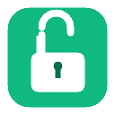

# Unblock Pro (우클릭 및 이미지/텍스트 복사 완벽 해제)

<p align="center">
  
</p>

<p align="center">
  
  
  
  
  
</p>

---

**Unblock Pro**는 네이버 블로그, 티스토리, 노션, 뉴스 사이트 등 상용 웹사이트의 정교한 우클릭 방지, 텍스트 드래그 차단, 투명 오버레이를 통한 이미지 저장 방지막을 완벽하게 무력화하는 실전형 크롬 확장 프로그램(Manifest V3)입니다.

단순한 Content Script 단일 방식이 아닌, **Isolated World와 Main World를 동시 제어하는 듀얼 컨텍스트 아키텍처**로 설계되어 웹사이트 고유 방어 코드를 원천 차단합니다.

---

## 👨‍💻 개발자 정보 (Developer Information)

- **개발자**: `cybereun`
- **GitHub**: [@cybereun](https://github.com/cybereun)
- **문의 및 피드백**: GitHub Issues / Pull Requests

---

## ✨ 핵심 특징 (Features)

1. **듀얼 컨텍스트(Isolated World + Main World) 동시 제어**
   - **Isolated World (`content_isolated.js`)**: 브라우저 최상위 캡처링 단계(`capture: true`)에서 사이트 이벤트 리스너로 전파되기 전 `stopImmediatePropagation()`으로 차단.
   - **Main World (`inject_main.js`)**: 웹페이지 실제 DOM에 직접 침투하여 `document.oncontextmenu = return false`와 같은 인라인 핸들러를 제거하고 `MutationObserver`로 동적 요소까지 상시 정화.

2. **투명 방어막(Overlay) 무력화 및 포인터 이벤트 제어 (`unblock.css`)**
   - 이미지 위를 덮고 있는 투명 보호 `div`나 `::after` 가상 요소를 마우스가 통과하도록 `pointer-events`를 자동 조정.
   - 이미지 우클릭 시 일반 컨텍스트 메뉴가 아닌 **"이미지를 다른 이름으로 저장..."** 및 **"이미지 복사"** 메뉴 정상 출력.

3. **원클릭 실시간 토글 & 단축키 지원**
   - 툴바 아이콘 클릭 또는 단축키(`Alt + R`) 입력으로 ON/OFF 즉시 전환 (새로고침 불필요).
   - Figma, Google Docs 등 웹 툴 사용 시 간섭 없이 손쉽게 비활성화 가능.
   - 뱃지 텍스트(초록색 `ON` / 회색 `OFF`)로 현재 작동 상태 직관적 확인.

4. **Iframe 침투 지원**
   - `all_frames: true` 및 `match_about_blank: true` 지원으로 네이버 블로그/카페처럼 iframe 내부에 본문이 위치한 사이트 완벽 지원.

---

## 📥 설치 방법 (Installation)

### 방법 1. 릴리즈 ZIP 파일 다운로드 설치 (권장)

1. [GitHub Releases](https://github.com/cybereun/unblock-pro-extension/releases) 페이지에서 최신 버전(`unblock-pro-v1.0.0.zip`)을 다운로드합니다.
2. 다운로드한 ZIP 파일의 압축을 원하는 폴더에 풉니다.
3. 크롬 브라우저를 열고 주소창에 `chrome://extensions`를 입력하여 이동합니다.
4. 우측 상단의 **개발자 모드(Developer mode)** 스위치를 켭니다.
5. 좌측 상단의 **압축해제된 확장 프로그램을 로드합니다(Load unpacked)** 버튼을 클릭합니다.
6. 압축을 해제한 폴더(`unblock-pro-extension`)를 선택하면 설치가 완료됩니다!

### 방법 2. Git 저장소 클론

```bash
git clone https://github.com/cybereun/unblock-pro-extension.git
```
이후 `chrome://extensions`에서 클론된 폴더를 로드합니다.

---

## ⌨️ 단축키 안내

| 기능 | Windows / Linux | macOS |
| :--- | :--- | :--- |
| **우클릭 해제 ON / OFF 토글** | `Alt + R` | `Alt + R` |

---

## 🛠️ 프로젝트 구조

```
unblock-pro-extension/
├── manifest.json        # MV3 확장 프로그램 매니페스트
├── background.js        # Background Service Worker (토글 및 뱃지 제어)
├── content_isolated.js  # Isolated World 스크립트 (이벤트 캡처링 차단)
├── inject_main.js       # Main World 스크립트 (인라인 방어코드 무력화)
├── unblock.css          # CSS 레벨 텍스트 드래그 허용 및 오버레이 통과
├── icons/
│   └── icon128.png      # 128x128 전용 아이콘
└── README.md            # 안내 문서
```

---

## 📄 라이선스 (License)

이 프로젝트는 [MIT License](LICENSE)에 따라 배포됩니다.
